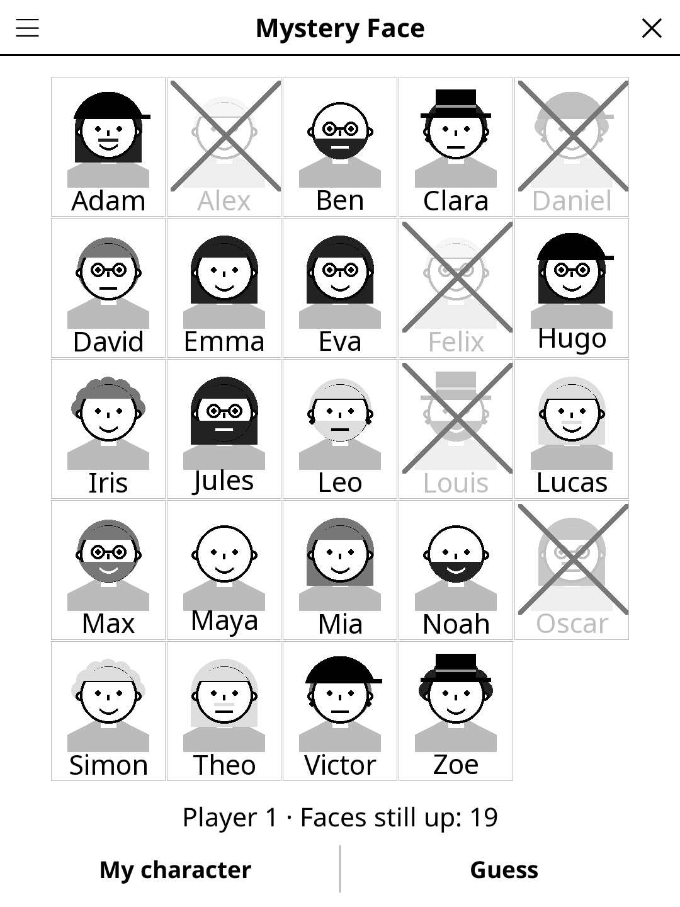

# mysteryface.koplugin

**Mystery Face** (*Devine le personnage*) is a guessing game for
[KOReader](https://github.com/koreader/koreader), played by two people with a
reader each. Both readers show the same gallery of faces; each player has a
secret character. Ask yes/no questions and be the first to find the other's.

## How to play

1. One player opens **New game → Start a game** and reads the five-digit
   code aloud; the other opens **New game → Join a game** and types it. One
   is player 1, the other player 2.
2. **My character** shows yours, with its looks spelled out (hair, glasses,
   hat, beard, earrings, smile), so every answer is right.
3. Take turns asking one yes/no question about looks: "Does your character
   wear glasses?". Tap the faces the answer rules out; they turn grey.
4. When you think you know, tap **Guess**, then the face. Your reader checks
   it: right, you win; wrong, you lose.

## Features

- **No connection needed** — both readers build the same gallery and the
  same two secrets from the code, so the guess is checked on the spot.
- **Drawn faces** — hair (bald, short, long, curly; dark, grey, light),
  glasses, cap or top hat, beard or moustache, earrings, smile.
- **16 or 24 faces**, set by the player who starts; names are the same in
  every language, so two readers in different languages still agree.
- **Auto-save**; **Show the game code** reads it again.
- French, Spanish and German translations.

## Why e-ink friendly?

The gallery is static; flipping a face repaints it once.

## License

GPL-3.0
